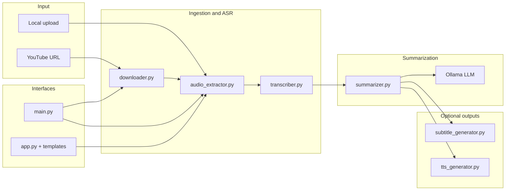

# Video Summarizer — Project Overview

Automatic video summarization for **educational content**: turn long lecture or tutorial videos into readable summaries, with optional narrated audio and synchronized subtitles. Processing runs **locally** (Whisper + Ollama) so transcripts and summaries stay on your machine.

---

## What It Does

| Stage | Output |
|--------|--------|
| Video in (YouTube URL or local file) | — |
| Audio extraction | `audio.mp3` |
| Speech-to-text | `transcript.txt`, `segments.json` (with timestamps) |
| LLM summarization | `summary.txt`, `summary_segments.json`, `summary_metadata.json` |
| Optional (CLI pipeline) | `summary.srt`, `audio_explanation.mp3` |

The summarizer is tuned for **learning**: it extracts concepts, ranks them (CRITICAL / IMPORTANT / SUPPORTING), filters by “depth” (compression), then writes structured summaries—not a single generic paragraph.

---

## High-Level Architecture



---

## Repository Layout

```
video-summarizer/
├── app.py                 # Flask web app (async jobs, upload API)
├── main.py                # CLI: full 6-step pipeline
├── config.py              # Paths, Whisper/Ollama defaults
├── requirements.txt
├── templates/index.html   # Web UI
├── static/css/style.css
├── static/js/app.js       # Upload, progress polling, results
├── downloads/             # YouTube downloads (auto-created)
├── output/                # Per-job or default pipeline artifacts
└── src/
    ├── downloader.py      # yt-dlp + YouTube client fallbacks
    ├── audio_extractor.py # FFmpeg → MP3
    ├── transcriber.py     # faster-whisper + term correction
    ├── summarizer.py      # Ollama multi-pass summarization
    ├── subtitle_generator.py
    ├── tts_generator.py   # Edge TTS (+ gTTS fallback)
    ├── text_cleaner.py    # Markdown → speech/subtitle-friendly text
    ├── hierarchy_detector.py
    ├── natural_speech_generator.py
    └── domain_handler.py  # Code/math/chem/physics pronunciation hints
```

---

## Two Ways to Run

### 1. Web app (`app.py`)

- Start: `python3 app.py` → http://localhost:5000
- **Current UI**: upload a video file (MP4, MKV, AVI, MOV, etc., up to 500 MB).
- Background thread per job; client polls `/api/progress/<job_id>` and fetches `/api/results/<job_id>`.
- Each job gets `output/<job_id>/` with transcript, segments, summary, and metadata.
- **Note**: The live web pipeline today stops after summarization. TTS and SRT are implemented in `src/` and wired in `main.py`, not yet in `app.py`. `SETUP.md` describes a fuller UI (YouTube tab, audio, subtitles, history)—treat that as target/planned UX where it exceeds `app.py`.

### 2. CLI (`main.py`)

Full pipeline in one command:

```bash
python3 main.py "https://www.youtube.com/watch?v=VIDEO_ID" --quality 360 --model llama3.2:3b
python3 main.py --test-ollama
```

Steps: download → extract audio → transcribe → summarize → subtitles → audio explanation.

Individual modules also support standalone CLI via `python src/<module>.py ...`.

---

## Pipeline Stages (Detail)

### Step 1 — Video source (`src/downloader.py`)

- **YouTube**: `yt-dlp` with validated URLs only (`youtube.com`, `youtu.be`).
- **Anti-bot / SABR**: retries with multiple `player_client` profiles (android, tv, ios, web_embedded).
- **Local files**: `get_local_video()` / `handle_video_source()`—no download.
- Downloads land under `downloads/<sanitized-title>/`.

### Step 2 — Audio (`src/audio_extractor.py`)

- FFmpeg extracts the audio track to `audio.mp3` in the job output directory.
- Requires `ffmpeg` on `PATH`.

### Step 3 — Transcription (`src/transcriber.py`)

- **Engine**: [faster-whisper](https://github.com/SYSTRAN/faster-whisper) (default model from `config.py`: `base`, CPU).
- **Pass 1**: transcribe with optional `initial_prompt` from an external **subtitle-gen** dictionary (optional; path in `config.SUBTITLE_GEN_DIR`).
- **Pass 2**: domain term correction—exact dictionary lookup, fuzzy match for “suspicious” tokens, `uncertain_terms.json` for manual review.
- **Writes**: `transcript.txt`, `segments.json` (`start`, `end`, `text`).

### Step 4 — Summarization (`src/summarizer.py`)

Uses **Ollama** at `OLLAMA_HOST` (default `http://localhost:11434`).

**Multi-pass logic** (scales to long videos):

1. **Chunk** transcript on sentence boundaries (~2500 tokens per chunk).
2. **Pass 1 — Extract & rank**: For each chunk, LLM lists concepts tagged `[CRITICAL]`, `[IMPORTANT]`, `[SUPPORTING]`, with `[chunk:N]` tags.
3. **Pass 2 — Global selection**: `compression` controls how many concepts to keep:
   - `high` → ~20% (quick)
   - `medium` → ~60% (balanced, default)
   - `low` → 100% (comprehensive)
   - All CRITICAL concepts are kept; remaining slots fill from IMPORTANT then SUPPORTING.
4. **Pass 3 — Write**: Per chunk, summarize only selected concepts (no second re-compression pass that would drop topics).
5. **Timestamp linking**: `link_summary_to_segments()` maps summary sentences back to Whisper segment times → `summary_segments.json`.

Config knobs: `SUMMARIZATION_MODEL`, `SUMMARY_TEMPERATURE`, `SUMMARY_MAX_TOKENS`, `SUMMARY_RATIO`.

### Step 5 — Subtitles (`src/subtitle_generator.py`)

- Reads `summary_segments.json`.
- Cleans text like audio (markdown strip, list → prose, `DomainHandler`).
- Emits standard **SRT** with `format_timestamp()`.
- Can align subtitle text with the exact TTS transcript when provided.

### Step 6 — Audio explanation (`src/tts_generator.py`)

- Primary: **Microsoft Edge TTS** (`en-US-GuyNeural`, slightly slower rate).
- Text pipeline: `text_cleaner`, `hierarchy_detector`, `natural_speech_generator`, abbreviation expansion.
- Fallback: **gTTS** if Edge TTS fails.
- Output: `audio_explanation.mp3` (may use FFmpeg for format conversion).

---

## Web API (Flask)

| Method | Path | Purpose |
|--------|------|---------|
| GET | `/` | Dashboard |
| POST | `/api/summarize` | `file`, optional `model`, `compression` → `{ job_id }` |
| GET | `/api/progress/<job_id>` | `{ current_step, progress, status }` |
| GET | `/api/results/<job_id>` | Summary text and lengths when complete |
| GET | `/download/summary/<job_id>` | Download `summary.txt` |

Job state is held in memory (`jobs` dict); restarting the server loses in-flight job handles (files on disk under `output/<job_id>/` may still exist).

Progress steps in the web app: `loading` → `extracting_audio` → `transcribing` → `summarizing`.

---

## Configuration (`config.py`)

| Setting | Default | Role |
|---------|---------|------|
| `WHISPER_MODEL` | `base` | Whisper size (tiny … large) |
| `WHISPER_DEVICE` | `cpu` | Inference device |
| `VIDEO_QUALITY` | `360p` | Label/default quality context |
| `OLLAMA_HOST` | `http://localhost:11434` | LLM API |
| `SUMMARIZATION_MODEL` | `llama3.2:3b` | Default Ollama model |
| `SUMMARY_TEMPERATURE` | `0.3` | Generation randomness |
| `DOWNLOADS_DIR` / `OUTPUT_DIR` | `./downloads`, `./output` | Artifacts |

External (optional): `SUBTITLE_GEN_DIR`, `YOUTUBE_TOOLS_DIR` for term correction and other local tooling—not required for core operation.

---

## Dependencies

From `requirements.txt`:

- **flask** — web server  
- **yt-dlp** — YouTube download  
- **faster-whisper** — ASR  
- **pydub** — audio utilities  
- **ollama** — Python client for local LLM  
- **edge-tts**, **gtts** — speech synthesis  

System tools: **Python 3.9+**, **FFmpeg**, **Ollama** with models pulled (e.g. `ollama pull llama3.2:3b`).

---

## Project Phases (README status)

| Phase | Scope | Status |
|-------|--------|--------|
| Week 1 | Download, audio, transcribe | Done |
| Week 2 | Ollama summarization, web UI | Done (web: upload + summary) |
| Week 3 | YouTube in UI, TTS, subtitles, job history | Partial: modules + CLI; web catch-up |

---

## Design Choices Worth Knowing

1. **Local-first privacy**: No cloud ASR/LLM required; good for college demos and offline-after-model-download use.
2. **Concept-driven compression**: Depth is “how many ranked concepts to keep,” not a fixed word count—works better across short and long videos.
3. **Global concept selection**: Concepts from all chunks are ranked together so one dense section does not starve another.
4. **Shared text cleaning**: Subtitles and TTS use the same cleaning path so narration and captions stay aligned.
5. **Educational domain hooks**: Optional subtitle-gen dictionary + `DomainHandler` for symbols in code, math, chemistry, physics.

---

## Quick Troubleshooting

| Issue | What to check |
|-------|----------------|
| Ollama errors | `ollama serve`, `ollama list`, model pulled |
| FFmpeg missing | `ffmpeg -version`, install via brew/apt |
| Slow transcription | Normal on CPU; use smaller Whisper model or GPU if available |
| YouTube download fails | Use local upload; update yt-dlp; try CLI with client fallbacks |
| subtitle-gen warning | Optional; app runs with no-op correction stubs |

See also `SETUP.md` for first-time machine setup and `README.md` for week-by-week onboarding commands.

---

## Typical Artifact Tree (one job)

```
output/<job_id>/
├── audio.mp3
├── transcript.txt
├── segments.json
├── uncertain_terms.json      # if any
├── summary.txt
├── summary_segments.json
├── summary_metadata.json
├── summary.srt               # CLI / future web
└── audio_explanation.mp3     # CLI / future web
```

---

*Generated as a consolidated project reference for developers and reviewers.*
