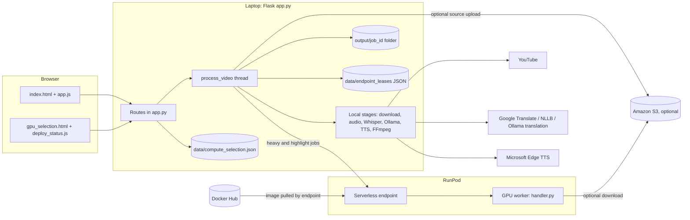
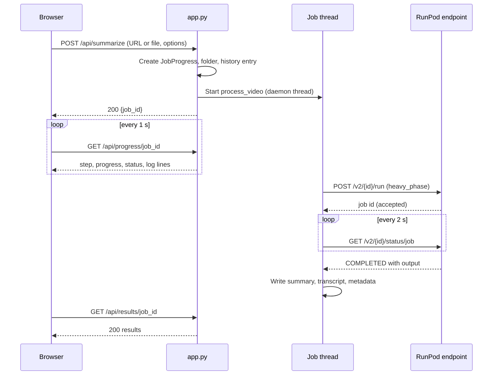
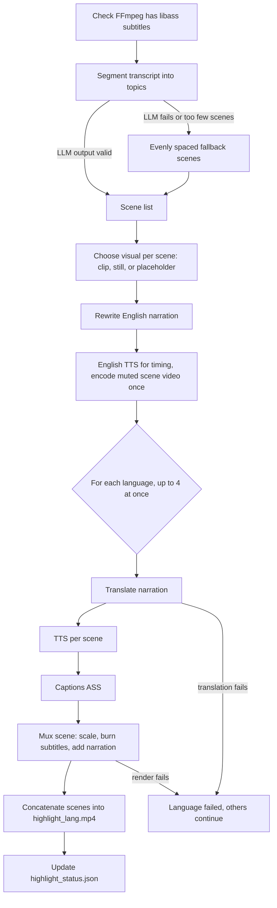
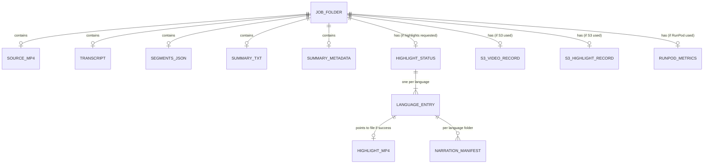
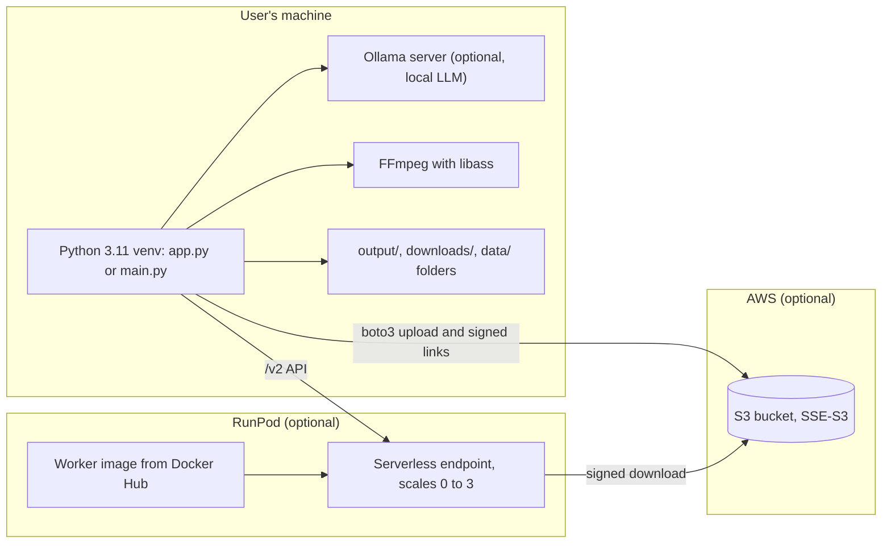

# 3. System Architecture

[← Features](02-features.md) · [Index](../PROJECT_DOCUMENTATION.md) · Next: [Tech Stack →](04-tech-stack.md)

## 3.1 Components and responsibilities

| Component | Files | Responsibility |
|---|---|---|
| Web app and API | `app.py` | Flask routes, starts one background thread per job, holds job state in memory, reads results from disk |
| Web front end | `templates/index.html`, `templates/gpu_selection.html`, `templates/partials/*.html`, `static/js/app.js`, `static/js/deploy_status.js`, `static/css/style.css` | Pages, forms, polling, results, GPU page |
| Settings | `config.py`, `src/locales.py` | Model names, paths, highlight tuning, language definitions |
| Ingestion | `src/downloader.py`, `src/youtube_errors.py`, `src/job_video.py` | YouTube download, error classes, copying the source into the job folder |
| Audio and speech-to-text | `src/audio_extractor.py`, `src/transcriber.py` | FFmpeg audio extraction; faster-whisper transcription with term correction |
| Summarization | `src/summarizer.py`, `src/summary_jobs.py` | Ranked-concept extraction and writing via Ollama; timestamp linking |
| Translation | `src/summary_translate.py`, `src/translators/*`, `src/translation_cache.py`, `src/term_protection.py` | Translation chain (Google, NLLB, Ollama), cache, protected terms |
| Narration and subtitles | `src/tts_generator.py`, `src/subtitle_generator.py`, `src/text_cleaner.py`, `src/hierarchy_detector.py`, `src/natural_speech_generator.py` | Speech text preparation, Edge TTS / gTTS, SRT output |
| Highlight videos | `src/highlight_*.py`, `src/visual_extractor.py`, `src/topic_segmentation.py`, `src/narration_rewrite.py` | Scene segmentation, visual choice, narration, captions, FFmpeg assembly |
| Execution routing | `src/pipeline_runtime.py`, `src/pipeline_executor.py` | Chooses local, pod or serverless for each job; runs each stage in that place |
| GPU deployment | `src/compute_deploy.py`, `src/gpu_selection.py`, `src/gpu_recommendations.py`, `src/serverless_worker_image_publish.py`, `src/runpod_serverless_*.py` | Creates and updates RunPod endpoints, builds and publishes the worker image |
| RunPod job client | `src/runpod_serverless.py`, `src/runpod_serverless_payload.py`, `src/runpod_serverless_endpoint_config.py` | Submits `/run` jobs, polls status, shrinks payloads, endpoint settings |
| Pod transport (legacy) | `src/runpod_ssh.py`, `src/runpod_jupyter.py`, `src/runpod_heavy_core.py`, `src/runpod_nllb_proxy.py` | SSH or Jupyter file transfer to a GPU pod |
| Capacity control | `src/endpoint_capacity.py` | Leases that keep the endpoint at zero workers when idle |
| Live status | `src/serverless_live_status.py`, `src/serverless_status_cache.py`, `src/compute_status.py` | Reads RunPod state, caches it for 5 s, names the state |
| Object storage | `src/s3_video_store.py` | Optional S3 upload of the source and highlights; presigned links |
| Worker | `runpod_worker/handler.py`, `runpod_worker/Dockerfile` | Runs `heavy_phase`, `highlight_phase`, `nllb_batch`, `warmup`, `diagnostic` jobs on the GPU |
| Safety | `src/log_safety.py` | Removes secrets from logs and error text |
| Command line | `main.py`, `download_transcript.py` | Terminal entry points |

## 3.2 Process and thread model

- **One Python process** runs the Flask server (`app.py:1231-1237`).
- **One thread per job**: `summarize` starts `threading.Thread(target=process_video, daemon=True)` (`app.py:832-845`).
- **Background recovery thread** for capacity leases, every 300 seconds, started at launch (`app.py:1232`,
  `src/endpoint_capacity.py:41`, `:242-264`).
- **Highlight languages render in parallel**, up to four at once (`src/highlight_pipeline.py:368`, the worker count is
  set by `HIGHLIGHT_RENDER_MAX_PARALLEL_LANGS`, `config.py:77-92`).
- **The browser** polls progress every second and deploy status every five seconds (`static/js/app.js:3`,
  `static/js/deploy_status.js:9`).

## 3.3 End-to-end data flow

1. The user submits a URL or file (`POST /api/summarize`, `app.py:778`). An uploaded file is saved to the system temp
   folder under `videosummarizer_uploads` (`app.py:83-84`).
2. A `JobProgress` object is created and a folder `output/<job_id>/` is made (`app.py:162-181`).
3. A background thread runs `process_video` (`app.py:283`), which moves through the steps in section 8.1.
4. Each stage either runs locally or is sent to RunPod, depending on the job's runtime (section 4.2).
5. Results are written to the job folder as files. The in-memory job is marked completed or failed.
6. The browser polls `/api/progress/<job_id>` until it sees `completed` or `error`, then calls `/api/results/<job_id>`
   (`static/js/app.js:645-688`, `:802-817`).
7. The results page reads summaries, audio and highlights through download routes.

## 3.4 Execution modes (per job)

Set on the GPU page, saved to `data/compute_selection.json` (gitignored), and resolved for each job by
`src/pipeline_runtime.py:67-144`:

| Mode | Heavy work (transcribe, summarize, summary translation) | Highlight rendering | Requirement |
|---|---|---|---|
| `local` (default) | This machine | This machine | Ollama running, FFmpeg installed |
| `runpod` + `serverless` | One `heavy_phase` job on the GPU worker (`src/pipeline_executor.py:126-205`) | GPU worker `highlight_phase`, or local if `RUNPOD_HIGHLIGHT_LOCAL` is set (`src/serverless_model_catalog.py:82-87`) | Deployed endpoint; `deploy_record_status=deployed` and an endpoint ID (`src/pipeline_runtime.py:101-106`) |
| `runpod` + `pod` (legacy) | Over SSH or Jupyter to a pod (`src/pipeline_executor.py:318-390`) | Always local | A running pod (`src/pipeline_runtime.py:122-127`) |

`build_executor` picks the class (`src/pipeline_executor.py:446-453`): `LocalPipelineExecutor`,
`HybridRunpodPipelineExecutor` (pod), or `ServerlessRunpodPipelineExecutor`.

## 3.5 Design decisions and why

Each decision lists the evidence: a code comment, the handoff notes, or the git history. Where none exists, the
reasoning is marked as an inference.

### D1. Local-first, with GPU as an option
- **Decision:** the default is local, and RunPod is an extra path (`src/pipeline_runtime.py:22-27`).
- **Why:** privacy and no cost by default (`docs/AI_HANDOFF_CONTEXT.md:14-16`, `PROJECT_OVERVIEW.md:233`).
- **Trade-off:** slower on a laptop, so the GPU path exists for long videos.

### D2. Files, not a database
- **Decision:** each job is a folder of files plus JSON status documents (`src/highlight_jobs.py`, `app.py:120-160`).
- **Why:** inspectable by hand, no server to run, and easy to copy or delete a job. Inference: the single-user design did
  not need a database.
- **Trade-off:** no queries across jobs; history is rebuilt by scanning folders at start-up (`app.py:120-160`); no
  transactions, so a crash mid-write can leave partial files.

### D3. Job state kept in memory
- **Decision:** `jobs = {}` and `job_history = []` (`app.py:81-82`).
- **Why:** simple progress polling. Inference: adequate for one local user.
- **Trade-off:** a restart loses live job handles. Files on disk remain, and history reloads them (`app.py:120-160`).
  The handoff notes say the same (`docs/AI_HANDOFF_CONTEXT.md`, section 8).

### D4. One shared muted picture track for all languages
- **Decision:** scene visuals are chosen and encoded once per job; each language adds only its own narration and captions
  (`src/highlight_shared_video.py:1`, `:44`).
- **Why (from the code's own comments):** "one shared muted video track per scene; languages differ only in audio +
  captions" (`src/highlight_shared_video.py:1`). The code gives no cost figure; a cost reason is inferred, not stated.
- **Trade-off:** all languages share the English timing, so a longer translation is cut at the scene length
  (`src/highlight_assembler.py:57-59`).

### D5. Deterministic LLM calls
- **Decision:** temperature 0 and seed 42 for segmentation and narration (`src/highlight_llm.py:1`, `config.py:72-73`,
  `src/topic_segmentation.py:79-94`).
- **Why:** the same input should give the same highlight plan (`src/highlight_llm.py:1` names this as the purpose).

### D6. No silent local fallback for remote highlights
- **Decision:** if the GPU worker fails, every requested language is recorded as failed, not rendered locally
  (`src/pipeline_executor.py:279-294`, comment "No silent local fallback").
- **Why:** a locally rendered video must never be reported as a worker result. Stated in the code comment.

### D7. Capacity leases to avoid paying for idle GPUs
- **Decision:** the endpoint stays at zero workers unless a lease is held; leases are released when the last job ends
  (`src/endpoint_capacity.py:3-4`).
- **Why:** an idle GPU worker is billed. Stated in the module docstring.
- **Trade-off:** leases live in S3 and are shared by all machines (`src/endpoint_capacity.py`); leases expire after four hours (`src/endpoint_capacity.py:37`), and jobs running longer
  lose their lease (`src/endpoint_capacity.py:13-17`).

### D8. No automatic retry on gateway errors
- **Decision:** HTTP 502, 503 and 504 on job submission are not retried (`src/runpod_serverless.py`, `submit_job`).
- **Why:** a second submit could start a second paid GPU job. Stated in the code comment at that point.
- **Trade-off:** a transient gateway error fails the highlight and the user must retry by hand (see
  [08-history-limits-results.md](08-history-limits-results.md), section 15).

### D9. Bundled fonts for captions
- **Decision:** fonts for each script are shipped in `static/fonts/` and registered in the worker image
  (`runpod_worker/Dockerfile:28-33`).
- **Why:** without them, libass draws empty boxes for non-Latin text (`runpod_worker/Dockerfile:28-30` comment; the
  project's own history of the issue is in [08-history-limits-results.md](08-history-limits-results.md)).

### D10. Payload size ladder for RunPod
- **Decision:** before sending audio or video to the worker, re-encode smaller until under 9 MB (`src/runpod_serverless_payload.py:12-14`,
  `:78-127`, `:343-383`); or send a signed S3 link instead (`:397-408`).
- **Why:** RunPod's `/run` body limit is about 10 MB (`src/runpod_serverless_payload.py:12`).

### D11. Pod transports: Jupyter when SSH is unreliable
- **Decision:** `RUNPOD_REMOTE_TRANSPORT=auto` uses Jupyter when the SSH proxy is the wrong host or the probe fails
  (`src/pipeline_executor.py:332-390`).
- **Why:** the handoff notes record SSH banner timeouts and proxy problems from the home network
  (`docs/AI_HANDOFF_CONTEXT.md`, section 6.1).

### D12. Hashed lock files for reproducible installs
- **Decision:** CI and the local launcher install from `requirements/*.lock` with `--require-hashes` (`.github/workflows/tests.yml:32,36`,
  `scripts/run_local_mac.sh`).
- **Why:** reproducible installs. The Dockerfile says the worker build must work offline from a wheel cache for the same reason
  (`runpod_worker/Dockerfile:12-20`).

### D13. transformers pinned to 4.49.0 with torch 2.4.1
- **Decision:** transformers 4.49.0 is pinned (`requirements/worker.in`, `runpod_worker/Dockerfile:14`).
- **Why:** "4.50+ refuses torch.load on torch<2.6 (CVE-2025-32434)" (`runpod_worker/Dockerfile:14`).

## 3.6 Diagrams

### 3.6.1 Architecture (components)

### 3.6.2 Sequence: submit a job and watch it

### 3.6.3 Flowchart: highlight video stages

### 3.6.4 Data model: files that describe a job

There is no database. This diagram shows which files refer to which, as a stand-in for an entity diagram.

### 3.6.5 Deployment

## 3.7 Security notes that affect architecture

Details are in [07-setup-security-testing.md](07-setup-security-testing.md). The main architecture points:

- The web app has no login. It is bound to `127.0.0.1` (`app.py:1237`), so only the same machine can reach it.
- Secrets live in `.env` (gitignored, `.gitignore:7`) and are read from the environment. The code does not print them;
  log redaction is in `src/log_safety.py`.
- Signed S3 links are generated per request and not stored (`src/s3_video_store.py:300`).
