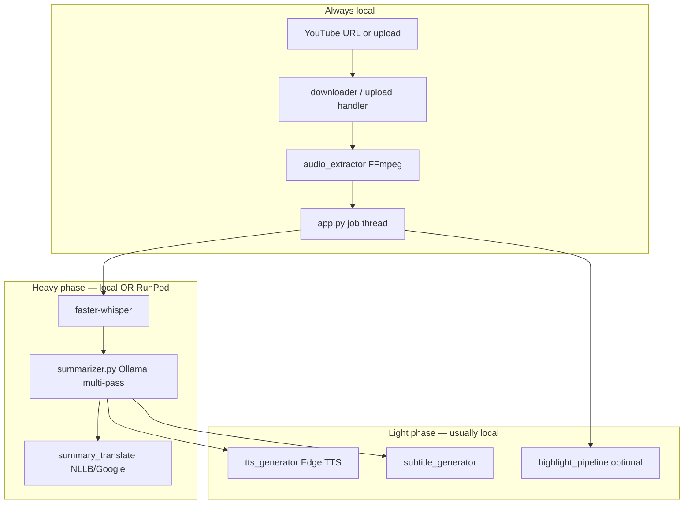

# Video Summarizer — Complete Context Handoff

**Purpose of this document:** Give another AI (or developer) full context on what was built, why, how it runs, and what is still in progress.  
**Last updated:** 2026-10-24 (Saturday)  
**Primary workspace:** `/Users/uks/Documents/Personal Proj/chunks/video-summarizer`  
**Owner:** Sanjay (college / demo project; teacher demo used a reduced `initial` branch; full product targets `main`)

---

## 1. What the product is

An **educational video summarizer**: long lecture/tutorial videos → structured text summary, optional **narrated audio + SRT**, and optional **multi-scene highlight videos** with burned-in captions.

**Design principles:**

- **Local-first** for privacy (Whisper + Ollama on laptop by default).
- **Concept-driven compression** (`high` / `medium` / `low`) — keeps ranked CRITICAL / IMPORTANT / SUPPORTING concepts, not a fixed word count.
- **Hybrid GPU path** when local CPU is too slow: RunPod for Whisper (CUDA), Ollama summarize, NLLB translation; laptop still does download, audio extract, UI, and (optionally) highlight FFmpeg.

---

## 2. Git branches and history (important)

| Branch | Role |
|--------|------|
| `initial` | ~50–60% demo for teacher: **upload-only** UI (YouTube tab hidden for that phase). Pushed to GitHub for presentation. |
| `main` | **Current full product** (as of Oct 2026): YouTube + upload, highlights, multilang, RunPod serverless deploy path. |
| `feature/key-scene-output-multilang-summary` | Where highlight Phase 1 + much Phase 2 work started. |
| `phase2-multilang-highlights` | Phase 2 multilanguage highlights merged toward main. |
| `feature/speed-and-translation-quality` | Pipeline speed + five-locale translation quality improvements. |
| `serverless-migration` | RunPod **Serverless** endpoint + custom worker Docker image (merged to main). |
| `cursor/runpod-jupyter-file-transfer` | Pod-era Jupyter HTTP fallback when SSH proxy failed. |

**Recent commits on `main` (newest first):**

1. `e9e1d22` — RunPod Serverless GPU deploy + automated worker image publish  
2. `4f8d74f` — Hybrid RunPod GPU pipeline + Jupyter file transfer fallback  
3. `2068dfb` — Pipeline speed + five-locale translation quality  
4. `49da4af` — Phase 2 multilanguage highlights + offline translation chain  
5. `ebb3959` — Highlight FFmpeg setup docs (macOS / Windows)

**Conversation archive:** Long Cursor thread on highlights + RunPod: [Key-scene & RunPod build](8e17a780-9e5d-48b0-b2d7-eb0eef75f025) (agent transcript).

---

## 3. End-to-end pipeline (conceptual)



### 3.1 Text-only path (baseline)

1. **Video in** — YouTube (`yt-dlp`, client fallbacks) or local upload (`/tmp/videosummarizer_uploads`, max 500 MB in Flask).
2. **Audio** — `audio.mp3` in `output/<job_id>/`.
3. **Transcribe** — `transcript.txt`, `segments.json` (Whisper segments with timestamps).
4. **Summarize** — `summary.txt`, `summary_segments.json`, `summary_metadata.json` via Ollama chunking + global concept selection.
5. **Optional CLI extras** — `summary.srt`, `audio_explanation.mp3` (`main.py`).

### 3.2 Highlight video path (opt-in)

Checkbox in web UI / `--highlight-video` in CLI. **Does not replace** text summary; adds `highlights/<lang>/highlight_<lang>.mp4`.

**Shared once per job (language-independent):**

- Topic segmentation → `highlight_scenes.json`
- Frame/clip selection → `visual_manifest.json`, assets under job dir
- Source video staged as `output/<job_id>/source.mp4` (`src/job_video.py`)

**Per language:**

- Narration rewrite (English base, then translate)
- Edge TTS per scene
- ASS captions (Noto fonts for Indic scripts)
- FFmpeg assembly (mute source audio; burn subtitles)

---

## 4. Product decisions (locked in discussion)

### 4.1 Highlight video (Phase 1 — English first)

| Decision | Choice |
|----------|--------|
| Opt-in | Checkbox / `--highlight-video`; extra download beside `summary.txt` |
| Scene count | ~8–15 scaled by compression (`high` / `medium` / `low`) |
| Visual default | **Still frame** (sharpness-ranked); **clip** only if motion score clearly exceeds threshold (raised so talking-head/slides stay still) |
| Source audio | Always muted |
| Captions | Same language as narration; word-boundary timing via Edge TTS metadata when available |
| Segmentation | LLM topic boundaries on chunked Whisper segments; validate `segment_ids` (integers, in range, strictly increasing); fallback to evenly spaced scenes if too few valid |
| Repeatability | Ollama `temperature=0`, fixed seed for segmentation + narration rewrite |
| FFmpeg | Cross-platform: `FFMPEG_PATH` → PATH → Homebrew; require `subtitles` filter (libass); Windows path escaping for `C:\` |

`link_summary_to_segments()` in `summarizer.py` **still used** for summary sentence timestamps; highlight uses **separate** topic segmentation — they coexist.

### 4.2 Multi-language (Phase 2)

| Decision | Choice |
|----------|--------|
| Languages | `en`, `hi`, `kn`, `te`, `ta` (registry in `src/locales.py`) |
| Deliverable | **One MP4 per language**, not multi-audio-track |
| User selection | At upload time; default English only |
| Transcript UI | Source language from Whisper; summary can be translated |
| Phase 1 preserved | When only `en` selected, behavior matches Phase 1 |

**Edge TTS voices (verified via `edge-tts --list-voices`):**

- `en` — `en-US-GuyNeural` (config) / fallback `en-IN-NeerjaNeural`
- `hi` — `hi-IN-SwaraNeural`
- `kn` — `kn-IN-SapnaNeural`
- `te` — `te-IN-ShrutiNeural`
- `ta` — `ta-IN-PallaviNeural`

Fonts under `static/fonts/` (Noto for Indic, DejaVu for Latin).

### 4.3 Translation strategy

- **Highlight scene text:** `src/highlight_translate.py` + chain in `src/translators/translation_chain.py`  
  Default chain: **Google → NLLB → Ollama** (env overrides: `HIGHLIGHT_TRANSLATOR`, `HIGHLIGHT_TRANSLATION_CHAIN`).
- **Summary text (dashboard):** `src/summary_translate.py` for per-language `summary_<lang>.txt` / JSON sidecars.
- **Term protection / transliteration:** `src/term_protection.py`, `src/simple_indic_translit.py`, caching in `src/translation_cache.py`.
- **Google rate limits:** circuit breaker (`src/translators/google_circuit.py`), delays configurable.

---

## 5. Execution modes (local vs GPU)

Controlled by **GPU selection page** + `data/compute_selection.json` + env.

| Mode | `pipeline_runtime` | `compute_mode` | Heavy work | Light work |
|------|-------------------|----------------|------------|------------|
| Full local | `local` | n/a | CPU Whisper, local Ollama | All local |
| Hybrid pod | `runpod` | `pod` | SSH or **Jupyter HTTP** to pod | Local |
| Hybrid serverless | `runpod` | `serverless` | RunPod `/v2/{endpoint_id}/run` jobs | Local (highlights optional on worker) |

**Key modules:**

- `src/pipeline_runtime.py` — resolves runtime for each job  
- `src/pipeline_executor.py` — `LocalPipelineExecutor`, `HybridRunpodPipelineExecutor`, `ServerlessRunpodPipelineExecutor`  
- `src/compute_deploy.py` — save selection, create pod or serverless endpoint, network volume  
- `src/compute_status.py` — live deploy banner for GPU page  

**Env (typical `.env`, not committed):**

- `RUNPOD_API_KEY`
- `RUNPOD_COMPUTE_MODE=serverless` (default in code)
- `RUNPOD_DATA_CENTER_ID` (e.g. `CA-MTL-1`)
- `RUNPOD_SERVERLESS_IMAGE` (Docker Hub tag for worker)
- `DOCKER_HUB_USER` (for auto build/push)
- `RUNPOD_SSH_IDENTITY`, `RUNPOD_SSH_PROBE_TIMEOUT` (pod mode)
- `RUNPOD_REMOTE_TRANSPORT=auto|jupyter|ssh` (pod mode; **auto** prefers Jupyter when proxy SSH is unreliable)

---

## 6. RunPod journey (what was tried → what we built)

This is critical context from Oct 23–24 sessions.

### 6.1 Pod + SSH problems

- Pod `a9th1441sq0z29`: **SSH banner exchange timeout** via `ssh.runpod.io` despite registered key and restarts.
- RunPod has **no general HTTP “exec command on pod” API** in the sense we needed; logs API exists but is not a job runner.
- **Root cause found for some pods:** created **without `startSsh: true`** → no `sshd`.
- Even with `startSsh: true` on a fresh RTX 4090 pod, **proxy SSH** could hang; **direct TCP** to published port was unreliable from Sanjay’s network.
- **Working pod transport:** **Jupyter HTTP proxy** (`https://<pod-id>-8888.proxy.runpod.net`) — login with pod Jupyter token, upload/download files, run heavy phase via notebook/kernel execution. Implemented in `src/runpod_jupyter.py`, wired in `HybridRunpodPipelineExecutor` when `RUNPOD_REMOTE_TRANSPORT=auto` detects bad proxy SSH.

### 6.2 Serverless (current direction on `main`)

**Why:** Avoid SSH entirely; scale-to-zero; one custom worker image runs Whisper + Ollama + NLLB (+ optional highlight FFmpeg).

**Docs:** `docs/RUNPOD_SERVERLESS.md`

**Worker image:** `runpod_worker/Dockerfile`

- Base: `runpod/pytorch:2.4.0-py3.11-cuda12.4.1-devel-ubuntu22.04`
- Installs: FFmpeg, Ollama, faster-whisper, edge-tts, app `src/`, handler `runpod_worker/handler.py`
- **Critical CUDA/torch issue:** Installing `transformers` via normal `pip` **replaced CUDA torch with CPU torch** → NLLB warmup failed with “PyTorch not found”.
- **Fix applied in repo:** install `transformers`, `sentencepiece`, `accelerate` with **`pip install --no-deps`** after other requirements so base image torch remains.

**Handler job types** (`runpod_worker/handler.py`):

| `input.phase` | Work |
|---------------|------|
| `heavy_phase` | Whisper + summarize + summary translation |
| `highlight_phase` | Full highlight pipeline on worker (if enabled) |
| `nllb_batch` | Batch NLLB translate |
| `warmup` | Pull Ollama model, load Whisper + NLLB (cold-start measurement) |

**Payload limits:** Async job body ~10 MB — audio/video gzip+base64; app may re-encode or fall back to **local highlight FFmpeg** (`RUNPOD_HIGHLIGHT_LOCAL=1` or `highlight_rendering: local` in saved models).

**Endpoint config (code defaults):** min workers 0, max 3, idle 5s, execution timeout 1h, FlashBoot, `RUNPOD_INIT_TIMEOUT=800` for multi-model cold start. See `src/runpod_serverless_endpoint_config.py`.

### 6.3 Deploy state as of 2026-10-24 (~12:00 IST)

From `data/compute_selection.json` (local machine):

| Field | Value |
|-------|--------|
| Endpoint ID | `4jxzzc08sr5z0w` |
| Network volume | `btzipnp6rn` |
| Data center | `CA-MTL-1` |
| GPU pool | `AMPERE_24` / RTX A5000 |
| Deployed image (RunPod) | `sanjayuk80603/video-summarizer-worker:v1.0.2` |
| `pipeline_runtime` | `runpod` |
| `warmup_status` | **failed** on v1.0.2 (NLLB / missing torch — see above) |

**In-flight work (same day):**

- Dockerfile fix saved locally for v1.0.3 (`--no-deps` transformers).
- **v1.0.3 docker build failed** at build-time sanity check: `ModuleNotFoundError: No module named 'regex'` because `--no-deps` skipped transformers’ dependency `regex`.  
  **Next fix for next AI:** add explicit deps for transformers that do not pull torch (e.g. `regex`, `tokenizers`, `safetensors`, `huggingface-hub`, …) or pin transformers version and install with a constraints file — **without** reinstalling torch.
- Docker images present locally: v1.0.0, v1.0.1, v1.0.2 — **not** v1.0.3.

**Operational checklist to finish serverless:**

1. Fix Dockerfile deps → build `linux/amd64` → push new tag (v1.0.3+).  
2. Patch endpoint `4jxzzc08sr5z0w` image via API or GPU page **Save selection & deploy**.  
3. Run warmup; confirm `COMPLETED` and `output.ok`.  
4. Run one full job with GPU toggle on; inspect `output/<job_id>/runpod_job_metrics.json`.

---

## 7. Repository map (high-signal files)

```
video-summarizer/
├── app.py                          # Flask UI, job threads, APIs, GPU page routes
├── main.py                         # CLI full pipeline + --highlight-video
├── config.py                       # Whisper, Ollama, highlight tuning knobs
├── download_transcript.py          # Standalone transcript utility (no Flask)
├── data/compute_selection.json     # Saved GPU/serverless deploy (gitignored in practice — may exist locally)
├── docs/
│   ├── RUNPOD_SERVERLESS.md
│   ├── SETUP.md
│   ├── PROJECT_OVERVIEW.md         # Slightly stale on web-only scope; still good for core ASR/LLM
│   └── AI_HANDOFF_CONTEXT.md       # This file
├── runpod_worker/
│   ├── Dockerfile
│   ├── handler.py
│   └── requirements-worker.txt
├── templates/index.html            # Dashboard, highlight langs, GPU page embeds
├── static/fonts/                   # Caption fonts
└── src/
    ├── downloader.py
    ├── audio_extractor.py
    ├── transcriber.py
    ├── summarizer.py
    ├── subtitle_generator.py
    ├── tts_generator.py
    ├── highlight_pipeline.py       # Orchestrator
    ├── highlight_chunking.py
    ├── topic_segmentation.py
    ├── visual_extractor.py
    ├── narration_rewrite.py
    ├── highlight_tts.py
    ├── highlight_captions.py
    ├── highlight_assembler.py
    ├── highlight_shared_video.py   # Shared scene video + per-lang mux
    ├── highlight_ffmpeg.py
    ├── highlight_jobs.py           # Status files, download paths
    ├── locales.py
    ├── summary_translate.py
    ├── pipeline_executor.py
    ├── pipeline_runtime.py
    ├── compute_deploy.py
    ├── compute_status.py
    ├── gpu_selection.py
    ├── runpod_serverless.py
    ├── runpod_serverless_payload.py
    ├── runpod_jupyter.py           # Pod fallback
    ├── runpod_ssh.py
    ├── serverless_model_catalog.py
    └── translators/                # google, nllb, ollama, chain, cache
```

**Scripts worth knowing:**

- `scripts/test_highlight_stage1.py` — chunk → segment → visuals  
- `scripts/run_text_only_regression.py` — ensure text path unchanged  
- `scripts/flask_smoke_test.py` — highlight on/off  
- `scripts/check_edge_tts_boundaries.py` — caption timing capability  

---

## 8. Web API (Flask) — summary

| Method | Path | Notes |
|--------|------|--------|
| GET | `/` | Dashboard + history |
| GET | `/gpu-selection` | RunPod catalog, deploy, model picks |
| POST | `/api/summarize` | `file` or YouTube, `compression`, `model`, `highlight_video`, `highlight_languages`, runtime |
| GET | `/api/progress/<job_id>` | Step + log lines |
| GET | `/api/results/<job_id>` | Summary + translations metadata |
| GET | `/download/summary/<job_id>` | Text summary |
| GET | `/download/highlight/<job_id>` | Default highlight |
| GET | `/download/highlight/<job_id>/<lang>` | Per-language MP4 |
| GET | `/job/<job_id>` | Sharable job view |

Job state is **in-memory** in `app.py` (`jobs` dict) — server restart loses handles; artifacts remain under `output/<job_id>/`.

---

## 9. Per-job artifact tree (full job)

```
output/<job_id>/
├── source.mp4
├── audio.mp3
├── transcript.txt
├── segments.json
├── summary.txt
├── summary_segments.json
├── summary_metadata.json
├── summary_translations.json       # if multilang summary requested
├── summary.srt / audio_explanation.mp3   # when those steps run
├── highlights/
│   ├── highlight_status.json
│   ├── highlight_scenes.json
│   ├── visual_manifest.json
│   ├── en/highlight_en.mp4
│   ├── hi/highlight_hi.mp4
│   └── ...
└── runpod_job_metrics.json         # if serverless heavy/highlight ran
```

---

## 10. How to run locally (developer)

**Prerequisites:** Python 3.9+, FFmpeg (with libass for highlights), Ollama with `llama3.2:3b` (and optionally `qwen2.5:7b-instruct`).

```bash
cd video-summarizer
python3 -m venv venv && source venv/bin/activate
pip install -r requirements.txt
ollama serve   # separate terminal
ollama pull llama3.2:3b
python3 app.py   # http://localhost:5000
```

**CLI:**

```bash
python3 main.py "https://www.youtube.com/watch?v=..." --highlight-video --compression medium
python3 main.py /path/to/lecture.mp4 --highlight-video --highlight-languages en,hi
```

**Windows demo machine:** See `SETUP.md` — full FFmpeg build + `FFMPEG_PATH`.

---

## 11. Worker build & deploy (serverless)

Manual:

```bash
docker build --platform linux/amd64 -f runpod_worker/Dockerfile \
  -t sanjayuk80603/video-summarizer-worker:v1.0.3 .
docker push sanjayuk80603/video-summarizer-worker:v1.0.3
```

Automated from app: GPU selection → **Custom worker** → **Save selection & deploy** (build/push if image missing).

See `docs/RUNPOD_SERVERLESS.md` for env vars and endpoint behavior.

---

## 12. Known issues / open work

| Issue | Status / note |
|-------|----------------|
| Serverless warmup on v1.0.2 | Fails NLLB due to torch/transformers install order |
| v1.0.3 build | Failed: missing `regex` when using `--no-deps` on transformers |
| `PROJECT_OVERVIEW.md` | Says web stops at summarize — **outdated**; main UI includes audio/SRT/highlights/GPU |
| Pod SSH from home network | Unreliable; use serverless or Jupyter transport |
| Disk space | Full disk once blocked Dockerfile saves; freed ~50 GB Oct 24 |
| `.env`, `data/compute_selection.json` | Contain secrets/IDs — do not commit |
| `translations_compare.md` | Large comparison artifact; not required for runtime |

**Suggested next tasks for continuity:**

1. Fix worker Dockerfile deps → successful v1.0.3+ build + warmup green.  
2. End-to-end GPU job on serverless with multilang highlight (watch payload size).  
3. Update `PROJECT_OVERVIEW.md` to match `main`.  
4. Optional: commit policy for `data/compute_selection.json` (template only in git).

---

## 13. Presentation / academic context

- **`Video_Summarizer_Presentation.pdf`** aligned with **`initial`** branch (reduced scope).  
- **`main`** is the target for “final” completion (YouTube, highlights, 5 languages, RunPod).  
- Phase naming in chats: **Phase 1** = English highlight video; **Phase 2** = five-language highlights + translation chain; **Phase 3** (implicit) = production GPU/serverless reliability.

---

## 14. Standalone utilities

**`download_transcript.py`** — Independent module/CLI for YouTube or local media → transcript only (no Ollama). Useful outside the Flask app.

---

## 15. Security notes (for maintainers)

- Do not pass user upload paths unsanitized into shell commands; existing code uses validated paths and subprocess with argument lists where refactored.
- RunPod API keys and Jupyter tokens live in `.env` / pod metadata — never log them.
- Google Translate via `deep-translator` is convenient but rate-limited; not for high-volume production without keys/quota planning.

---

*This handoff consolidates README, SETUP, PROJECT_OVERVIEW, RUNPOD_SERVERLESS, git history, and Cursor implementation discussions through 2026-10-24. Treat `data/compute_selection.json` and live RunPod console as source of truth for deploy IDs if they diverge from this file.*
